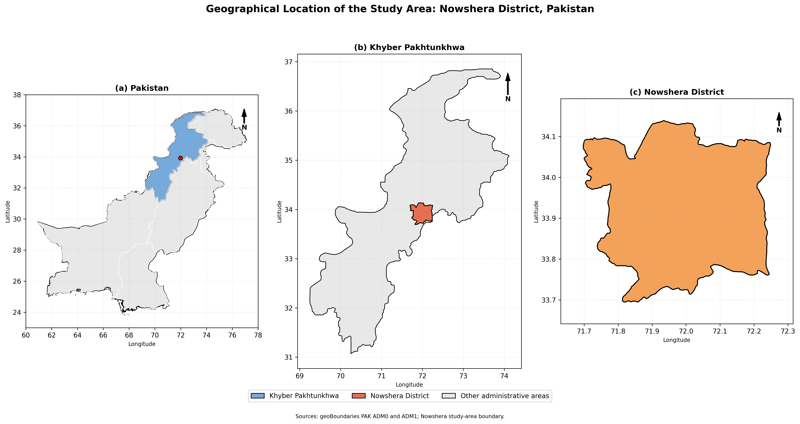
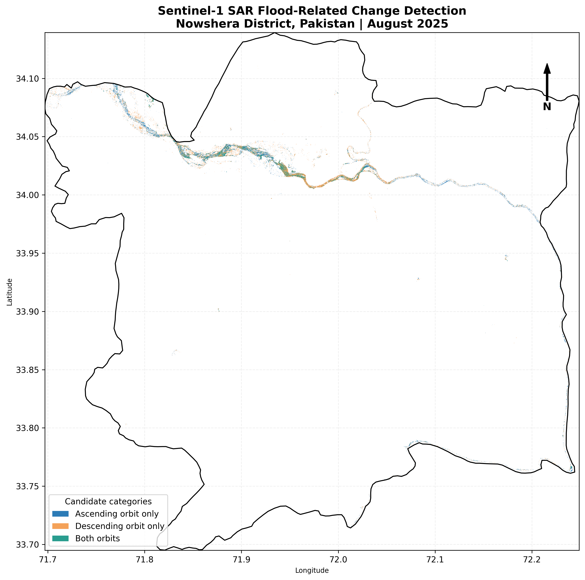
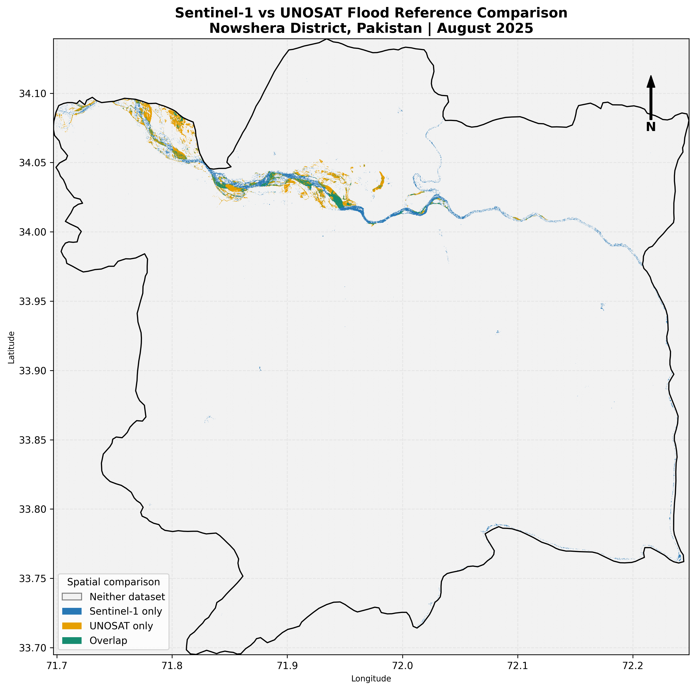
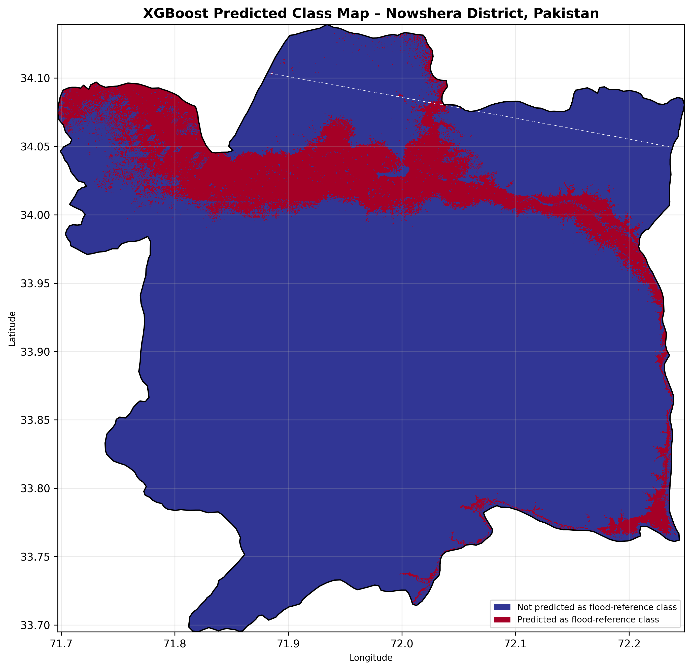
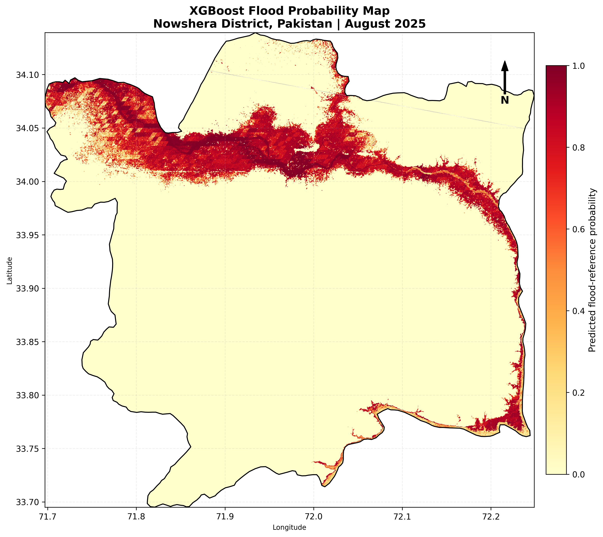
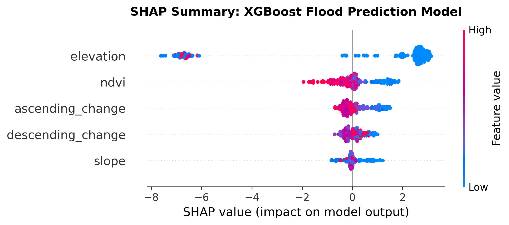

# FloodSense-AI
### Satellite-Based Flood Mapping and Machine Learning Analysis Using Sentinel-1, XGBoost, and SHAP

FloodSense-AI is a geospatial and machine learning project developed to identify potential flood-affected areas using Sentinel-1 Synthetic Aperture Radar (SAR) imagery, terrain information, vegetation indicators, and an XGBoost classification model.

The project combines satellite-based flood detection, machine learning, spatial validation against a UNOSAT reference dataset, and explainable AI to produce flood-related maps and statistical outputs.

The study focuses on flood conditions in **Khyber Pakhtunkhwa, Pakistan**, with particular attention to the Nowshera area.

---

## Project Objectives

The main objectives are:

1. Identify potential flood-affected areas using multi-temporal Sentinel-1 SAR imagery.
2. Examine changes in radar backscatter between pre-flood and post-flood observations.
3. Incorporate terrain and vegetation information into flood susceptibility modelling.
4. Develop an XGBoost classification model to identify potential flood-affected pixels.
5. Compare Sentinel-1-derived results with UNOSAT reference information.
6. Apply SHAP explainability to understand the contribution of individual predictors to model predictions.

---

## Methodology

The workflow consists of the following stages:

### 1. Study Area and Data Preparation

The study area was defined using administrative boundaries for Khyber Pakhtunkhwa, Pakistan.

The analysis integrates satellite imagery, terrain information, and reference flood data.

### 2. Sentinel-1 SAR Processing

Sentinel-1 GRD imagery was used to examine changes in radar backscatter.

The workflow includes:

- Selection of pre-flood and post-flood Sentinel-1 observations.
- Separate examination of ascending and descending orbital observations.
- Extraction of VV polarization backscatter.
- Calculation of backscatter differences.

The VV backscatter change was calculated as:

`VV Change = Post-flood VV − Pre-flood VV`

A threshold-based approach was used to identify potential flood-related changes in radar backscatter.

### 3. Environmental and Terrain Predictors

The machine learning model uses five predictor variables:

- Elevation
- Slope
- NDVI
- Ascending-orbit VV change
- Descending-orbit VV change

Elevation and slope provide information about terrain conditions, NDVI represents vegetation conditions, and Sentinel-1 backscatter differences capture radar changes between observation periods.

### 4. XGBoost Classification

An XGBoost classifier was trained to distinguish between the two reference classes:

- Class 0: Non-flood
- Class 1: Flood

A spatial group-based training and testing strategy was used to reduce the risk of nearby spatial observations appearing in both datasets.

The model produces classified flood-related predictions and probability estimates.

### 5. Model Evaluation

The model was evaluated using:

- Accuracy
- Precision
- Recall
- F1-score
- ROC-AUC
- Confusion matrix

The evaluation measures agreement with the UNOSAT-derived reference labels. These results should not be interpreted as independently verified flood-detection accuracy because the reference dataset has not been field validated.

### 6. UNOSAT Comparison

The Sentinel-1 candidate flood map was compared spatially with the UNOSAT reference dataset.

The comparison examines:

- Sentinel-1 candidate flood area
- UNOSAT reference flood area
- Spatial overlap
- Intersection over Union (IoU)

The comparison provides an indication of spatial agreement and disagreement between the two mapped datasets.

### 7. SHAP Explainability

SHAP (SHapley Additive exPlanations) was applied to interpret the XGBoost model.

It helps identify:

- Relative predictor importance
- The contribution of individual predictors
- How predictor values influence model predictions

SHAP explains the model's behaviour; it does not establish causal relationships between environmental variables and flooding.

---

## Model Performance

The following results are reported for the spatial test sample:

| Evaluation Metric | Result |
|---|---:|
| Accuracy | 0.908 |
| Precision (Flood Class) | 0.90 |
| Recall (Flood Class) | 0.97 |
| F1-score (Flood Class) | 0.94 |
| ROC-AUC | 0.928 |

**Interpretation:** The model demonstrates strong agreement with the reference labels on the spatial test sample. However, independent field validation would be required to establish real-world flood-detection accuracy.

---

## Project Outputs

The repository contains the final PNG map visualizations, statistical CSV files, and the complete analytical notebook.

### Maps and Visualizations

#### Study Area Map



#### Sentinel-1 Candidate Flood Map



#### UNOSAT Comparison Map



#### XGBoost Classified Map



#### XGBoost Probability Map



#### SHAP Explainability



### Statistical Results

The following CSV files are available in the `results/` directory:

- [Classification Report](results/FloodSense_Classification_Report.csv)
- [Confusion Matrix](results/FloodSense_Confusion_Matrix.csv)
- [UNOSAT Comparison Statistics](results/FloodSense_UNOSAT_Comparison_Statistics.csv)
- [Sentinel-1 Area Statistics](results/FloodSense_Sentinel1_Area_Statistics.csv)
- [SHAP Feature Importance](results/FloodSense_SHAP_Feature_Importance.csv)

### Analytical Notebook

The complete analytical workflow is available here:

[Open FloodSense AI Jupyter Notebook](notebooks/FloodSense_AI.ipynb)

---

## Repository Structure

```text
FloodSense-AI/
│
├── notebooks/
│   └── FloodSense_AI.ipynb
│
├── maps/
│   ├── FloodSense_Study_Area_Map.png
│   ├── FloodSense_Sentinel1_Candidate_Map.png
│   ├── FloodSense_UNOSAT_Comparison_Map.png
│   ├── FloodSense_XGBoost_Classified_Map.png
│   ├── FloodSense_XGBoost_Probability_Map.png
│   └── FloodSense_SHAP_Explainability.png
│
├── results/
│   ├── FloodSense_Classification_Report.csv
│   ├── FloodSense_Confusion_Matrix.csv
│   ├── FloodSense_UNOSAT_Comparison_Statistics.csv
│   ├── FloodSense_Sentinel1_Area_Statistics.csv
│   └── FloodSense_SHAP_Feature_Importance.csv
│
├── README.md
└── requirements.txt
```

---

## Technologies and Tools

- Google Earth Engine
- Google Colab
- Python
- Sentinel-1 SAR
- XGBoost
- SHAP
- Rasterio
- GeoPandas
- NumPy
- Pandas
- Matplotlib
- Scikit-learn
- Earth Engine Python API

---

## Reproducibility

The complete analytical workflow is provided in the Jupyter Notebook.

To reproduce the analysis:

1. Open the notebook in Google Colab.
2. Install the required Python dependencies using `requirements.txt`.
3. Authenticate your Google Earth Engine account.
4. Configure your own Earth Engine project ID.
5. Provide the required UNOSAT reference dataset.
6. Configure the Google Drive directory for project data.
7. Run the notebook cells sequentially.

Some input datasets and intermediate processing files must be obtained or generated separately before running the complete workflow.

---

## Data Availability

This repository includes:

- Analytical Jupyter Notebook
- Final PNG map visualizations
- Statistical CSV outputs
- Model evaluation results
- SHAP feature importance results

Large satellite input datasets, intermediate processing files, and the probability GeoTIFF are not included in the GitHub repository.

---

## Limitations

- The model relies on reference labels derived from the UNOSAT dataset.
- The reference dataset has not been independently field validated.
- Sentinel-1 backscatter changes can be influenced by vegetation, soil moisture, surface roughness, and other environmental conditions.
- Flood detection based on radar backscatter thresholds may produce false positives and false negatives.
- Spatial agreement with a reference map does not necessarily establish the actual extent of flooding.

---

## Research Significance

FloodSense-AI demonstrates an integrated geospatial workflow combining satellite remote sensing, terrain analysis, machine learning, spatial comparison, and explainable artificial intelligence.

The project highlights how Earth observation and machine learning can support flood-related spatial analysis and provide interpretable information for environmental monitoring and disaster-risk assessment.

**Author:** Qureshi Kinza

**GitHub Repository:** https://github.com/qureshi-kinza/FloodSense-AI
